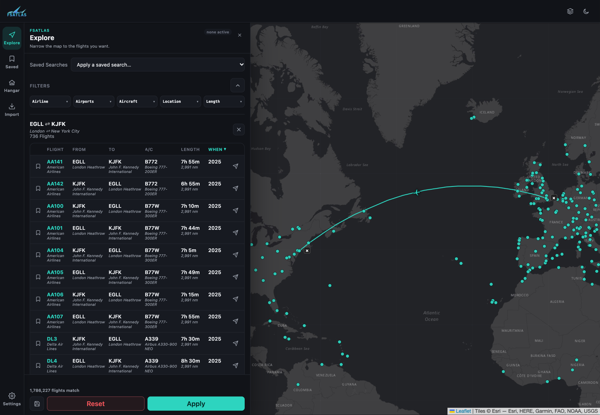
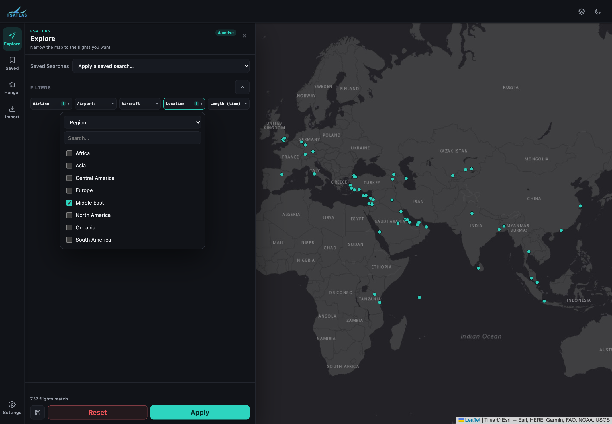
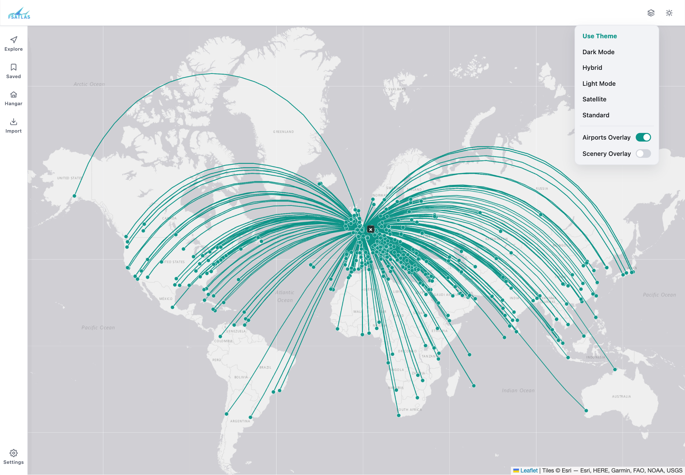

# FSAtlas

[](https://github.com/Leofric99/fsatlas/releases)
[](https://github.com/Leofric99/fsatlas)

<p align="center">
  
</p>

<p align="center">
  <a href="#quick-start">Quick Start</a> &nbsp;|&nbsp;
  <a href="#key-features">Features</a> &nbsp;|&nbsp;
  <a href="https://github.com/Leofric99/fsatlas/releases">Releases</a> &nbsp;|&nbsp;
  <a href="https://github.com/Leofric99/fsatlas">Source Code</a>
</p>

<h3 align="center">FSAtlas allows you to find inspiration for your next flight. Inspired by FlightConnections.</h3>

## What Is FSAtlas?

FSAtlas reads flight records from a local SQLite database and renders every departure and arrival airport as a colour-coded dot on an interactive map just like [FlightConnections](https://www.flightconnections.com), but free, and self-hosted.

Click an airport to explore its connections, select a destination to inspect the details of a route, and open an individual flight to view its specific details.

> FSAtlas is designed for finding inspiration for your next flight. It displays routes as an A - B. It is not designed to display routes as waypoints flows, SIDs, STARs, etc. [Simbrief](https://www.simbrief.com) is recommended for this.

## Key Features

### Explore the network

The full dataset is plotted as soon as the app opens. Airports are rendered as colour-coded points, with the colour and scale of each point reflecting how many non-stop destinations it serves. This makes busy hubs easy to spot while keeping the map readable. Click an airport to draw its route fan, then click a destination to list the flights between the two.

### Inspect flight details

Route results show the individual flights connecting the selected airports. Each row shows the airline, flight number and callsign, the aircraft type, the departure and arrival airports, the flight length and the year it was recorded (**When**). Click any column heading to sort by it, and use the SimBrief button on a row to send the flight to SimBrief.

<p align="center">
  
</p>

### Filter the flights

The **Explore** panel narrows the whole map with six filter menus: **Airline**, **Airports** (ICAO, IATA or name), **Aircraft** (ICAO code or full type), **Location** (city, country or region), **Length** and **Year**. Tick several values in a menu to match any of them; filters in different menus are combined, so only flights matching all of them remain. Length and Year each take a minimum and maximum with two sliders: Length works on flight time by default, or on distance if you pick it from the drop-down, and Year uses the year each flight was recorded. A badge shows how many filters are active, and a live count shows how many flights match before you press **Apply**. Use **Reset** to clear everything, or the bookmark button to save the current filters as a named search.

<p align="center">
  
</p>

### Save routes and searches

The **Saved** panel keeps the flights and filter searches you have bookmarked, so you can jump straight back to them later. Saved items are stored in `saved_items.json`.

### Choose how to view the map

Use the layers button in the top bar to choose between Dark Mode, Light Mode, Standard, Satellite, and Hybrid map styles, and to toggle the **Airports** and **Scenery** overlays. The theme button switches the light and dark UI, which alters the map, controls and surrounding panels, and your preference is remembered for the next visit.

<p align="center">
  
</p>

### Mark your installed scenery

The **Hangar** panel lets you pick your MSFS Community or X-Plane Custom Scenery folder. Package names and small manifests are checked locally (nothing is uploaded) and matching airports are starred on the map, with counts of matched and unresolved packages.

### Add and back up your data

The **Import** panel imports flights from CSV, JSON or database files by drag and drop, and exports the whole database to a location of your choice. See [Flight Data](#flight-data) below.

### Dispatch settings

The **Settings** panel stores your SimBrief pilot ID or username, which pre-fills dispatch links and powers the SimBrief export. It can be verified from the same panel.

> Airports are rendered on canvas, routes are calculated only when requested, and filtered map views are cached server-side per session. This keeps the initial map responsive while avoiding unnecessary repeated work.

## Flight Data

FSAtlas reads its flights from a SQLite database at `run/database/flights.db` (override the location with `FSATLAS_DB`). It holds one row per flight leg per season (`year` + `Summer`/`Winter`), linked to airport, airline and aircraft-type tables. The database is not stored in git because of its size - place your own copy at that path, or start with an empty one and fill it with the importer below. The full schema is in [`docs/reference/flight-data-schema.md`](docs/reference/flight-data-schema.md).

### Importing flights

Open the **Import & Export** panel (the "Import" rail icon, below Hangar) and drop one or more `.csv`, `.json` or `.db` files onto it, or click to choose them. Three formats are accepted:

- **Old-style `flights.csv`** - the original 25-column layout (`owner,reg,type,type_icao,flight_number,calsign,...,distance,rough_flight_time,timestamp_read`).
- **JSON** - a list of flight objects, or a dict holding the list under `flights`, `data` or `results`, using the same field names as the CSV columns.
- **Database (`.db`)** - another FSAtlas flight database, such as one saved with **Export database...** (below). It is merged in as it is, keeping every season.

The import:

- ignores flights that are already in the database (same flight number, departure, arrival and aircraft type);
- adds any airports, airlines and aircraft types it does not know yet;
- keeps only the year and season of each flight (`timestamp_read` is converted; `reg` is not stored);
- skips rows with no callsign, an estimated duration over 25 hours, or missing airport/date data.

Imported CSV and JSON files are kept in `run/import/processed/` (or `import/processed/` under `FSATLAS_DATA_DIR`); files that could not be imported go to `import/failed/`; database files are not kept. The same import is available from the command line: `python -m run.import_flights FILE [--dry-run]`.

### Exporting the database

Click **Export database...** in the same panel to save a copy of the whole database wherever you like, e.g. as a backup or to move it to another install, and drop that `.db` file on the Import box to bring it back. In Chrome and Edge you choose the folder and file name; other browsers download it to their downloads folder.

> `uv run fsatlas` still starts the original `run/web_gui.py` frontend, which reads `run/database/flights.csv` and does not use the database. `python -m run` (and the Docker image) start the web app described here.


## Quick Start

Choose the setup that best fits your environment.

### Linux & macOS

The `uv` installation is the quickest way to run FSAtlas locally for Linux and macOS.

#### Prerequisites

[**UV**](https://docs.astral.sh/uv/getting-started/installation/) — manages the isolated environment and makes the `fsatlas` command available on your `PATH`.

```bash
curl -LsSf https://astral.sh/uv/install.sh | sh
```

#### Installation

Clone the repository and move into the project directory:

```bash
git clone https://github.com/Leofric99/fsatlas.git
cd fsatlas
```

Before starting FSAtlas, place your flight database at `run/database/flights.db` (or import flights once it is running) as described in [Flight Data](#flight-data). `uv` will create the environment and install the dependencies when you run the project:

```bash
uv run fsatlas
```

This starts a local web server and opens FSAtlas in your default browser. If the browser does not open automatically, use the URL printed in the terminal, such as `http://127.0.0.1:PORT`.

## Docker

Run FSAtlas in a container using [Docker](https://docs.docker.com/get-docker/). This is useful when you want to run it as a detached service or access it from another device on your network. The flight database lives in the mounted `/data` directory (see below), so put your `flights.db` there or import flights through the GUI after starting.

#### Prerequisites

[**Docker**](https://docs.docker.com/get-docker/), included in Docker Desktop or available from your Linux distribution's package manager.

#### Build and run

```bash
docker build -t fsatlas .
docker run -d --name fsatlas -p 8777:8000 fsatlas
```

The container is now deployed and can be reached at `http://<server_ip>:8777` by default.

By default, the flight database (`/data/flights.db`), the `import/` folder and settings/saved
items (`settings.json`/`saved_items.json`) live inside the container and are lost when it's
recreated. To persist them on the host, bind-mount a directory to `/data` (see the `volumes:`
entry and its comment in `docker-compose.yml` for details). Copy an existing `flights.db`
into that directory, or start empty and import flights from the GUI; the settings files are
created automatically on first start if they don't exist.

To stop the service:

```bash
docker stop fsatlas
docker rm fsatlas
```

## Contributing

Contributions are very much welcome. To contribute, start a new branch and open a pull request.

If you find any bugs, please open a [GitHub Issue](https://github.com/Leofric99/fsatlas/issues).

If you have flight data that could be incorporated into the project, it would be most welcome. Please open an issue to start the conversation.

---

> [!NOTE]
> This project was developed with the assistance of [GitHub Copilot](https://github.com/features/copilot). I am not a front-end developer, so there may be bugs, rough edges, or unconventional code patterns. Contributions and bug reports are welcome!
